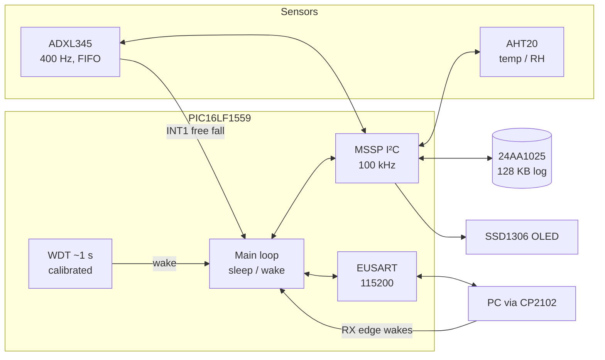

# Fallskynjari – battery-powered fall detector and environmental logger

*Fallskynjari* (Icelandic: "fall sensor") is a small embedded data logger built
around a **PIC16LF1559** microcontroller. It measures temperature and humidity
every 180 s, detects free falls with an accelerometer, calculates the fall
height from the measured free-fall time, and stores everything in an external
EEPROM. It is designed to run from 2 × AA cells using sleep mode and
interrupt-driven wake-up.

The project is a breadboard prototype. The firmware is written in C for the
Microchip XC8 compiler, with direct register-level drivers and no vendor
libraries.

> **Status:** working on the bench, powered from the PICkit 5 programmer.
> Battery operation, current consumption, the serial log readout and
> calibrated drop tests have **not** been tested yet.
> See [Current development status](#7-current-development-status).

---

## 1. Project overview

The design requirements for the device were:

| # | Requirement |
|---|---|
| 1 | Battery powered, at most 2 × AA, full operation for at least 2 days; use low-power features such as sleep mode and wake-up |
| 2 | Temperature measurement, ±1 °C accuracy, sampled every 180 s |
| 3 | Relative humidity measurement, ±5 %RH accuracy, sampled every 180 s |
| 4 | XYZ acceleration measurement from which the fall height can be calculated, range 0.2 m to 3 m |
| 5 | On-board memory that can log measurements for 2 days |
| 6 | Maximum enclosure size 160 × 80 × 45 mm |

How the firmware meets them:

- The PIC spends almost all of its time in **sleep**. The watchdog timer wakes it
  about once per second for timekeeping; the accelerometer wakes it through an
  external interrupt when a fall starts.
- Every 180 s it reads an **AHT20** temperature/humidity sensor and writes a
  timestamped record to a **24AA1025** 128 KB I²C EEPROM.
- An **ADXL345** accelerometer runs at 400 Hz with its hardware free-fall
  detector enabled. The PIC counts free-fall samples until impact and calculates
  the height as **h = ½·g·t²**.
- A 0.96" **SSD1306 OLED** shows status and fall results; it is switched off
  most of the time to save power.
- A **serial console** (115200 baud, CP2102 USB-serial adapter) dumps the log as
  CSV.

## 2. Key features

Implemented in [`logger/main.c`](logger/main.c):

- **Low-power operation:** sleep between events. The watchdog wakes the PIC
  about once per second (software-enabled WDT), and the ADXL345 INT1 line wakes
  it on the RA2/INT pin.
- **Self-calibrating timekeeping:** the watchdog's low-frequency oscillator
  (LFINTOSC) is measured against the 16 MHz HFINTOSC every 180 s, and time spent
  awake is counted with Timer1.
- **Fall height measurement:** the ADXL345 runs at 400 Hz with its FIFO in
  stream mode, so the samples from the start of the fall are still available
  when the PIC wakes up. The resolution is 2.5 ms per sample.
- **Event and environment logging:** 16-byte records with a type, a timestamp
  and a checksum, 8192 records in total. After a reset the firmware finds the
  end of the log by binary search.
- **Shared I²C bus:** four devices on one bus, using the PIC's MSSP peripheral
  at 100 kHz. Every bus wait has a timeout.
- **Fault reporting:** at boot the firmware checks that both bus lines idle
  high, then probes each device. Faults are reported as LED blink codes, and an
  on-screen I²C bus scan is shown when a device is missing.
- **Serial console:** wakes on a key press (interrupt-on-change on the RX pin)
  and offers status, a CSV dump and log erase. *Implemented, not yet tested on
  hardware.*

## 3. Hardware components

| Component | Function | Interface |
|---|---|---|
| Microchip PIC16LF1559 (20-pin DIP) | MCU, 8 K words flash, 512 B RAM, 1.8–3.6 V | — |
| Aosong AHT20 module | Temperature and humidity | I²C 0x38 |
| DFRobot SEN0032 (ADXL345) | 3-axis accelerometer, ±16 g full resolution | I²C 0x53, INT1 → RA2 |
| Microchip 24AA1025 | 128 KB (1 Mbit) EEPROM | I²C 0x50 / 0x54 |
| 0.96" SSD1306 OLED, 128 × 64 | Local display | I²C 0x3C |
| Microchip PICkit 5 | Programming and bench power | ICSP |
| CP2102 USB-serial adapter | Log readout | UART 115200 8N1 |
| LED + 330 Ω | Status and error codes | RC0 |

Full pinout and wiring: [`docs/hardware.md`](docs/hardware.md).

## 4. Software and development tools

| Tool | Version | Use |
|---|---|---|
| Microchip XC8 | v3.00 | C compiler (`-O2`) |
| MPLAB X IDE / IPE | v6.20 | `ipecmd` command-line programmer |
| PIC12-16F1xxx device pack | 1.7.242 | Device support |
| PICkit 5 | firmware 02.03.64 | In-circuit programming |
| Claude Code | — | Development assistant (see [`docs/development.md`](docs/development.md)) |

The firmware is a single C file without an IDE project. It builds from the
command line, see [Building and flashing](#9-building-and-flashing).

## 5. System architecture



Main loop, simplified:

1. Add the time spent awake (Timer1) to the clock, then sleep with the watchdog
   enabled.
2. On wake-up, check the cause:
   - **RX pin edge:** open the serial console.
   - **INT1:** measure the fall, write a fall record, show the result.
   - **Watchdog:** add one calibrated tick to the clock.
3. If 180 s have passed: read the AHT20, write an environment record and
   recalibrate the oscillator.

Module structure, the fall algorithm and the log format:
[`docs/architecture.md`](docs/architecture.md).

## 6. Technical challenges and solutions

All of these came up during development. More detail is in
[`docs/development.md`](docs/development.md).

| Problem | Diagnosis | Solution |
|---|---|---|
| Programmer reported *Invalid Device ID 0x0* after new parts were added | The MCLR wire had come loose (found when the wiring was checked) | Reconnected it; documented as the first check |
| OLED dark and the firmware hung after the OLED was added | The firmware blocked forever waiting for an I²C flag. The device data file showed that the MSSP SDA line can only be on RB4 or RA3, and the wire was on RB5 | Moved the wire to RB4. Added timeouts, a bus-idle check and LED error codes so a bus fault can't hang the firmware |
| Watchdog oscillator inaccurate | Measured LFINTOSC at **29,275 Hz** against 31 kHz nominal (−5.6 %), which would put the 180 s interval at about 190 s | Timer1 counts LFINTOSC cycles over 200 ms of HFINTOSC time, and the tick length is recalculated every 180 s |
| Clock lagged about **3 s per 3 min** | Only time spent asleep was counted. The display updates each second added uncounted awake time | Timer1 counts LFINTOSC/8 whenever the CPU is awake. After the fix the error was **under 1 s per 3 min** (stopwatch check) |
| Fall timing resolution | At 100 Hz a 0.2 m fall has about ±10 % height error. The fall also starts before the PIC wakes up | 400 Hz sample rate (±2.5 % at 0.2 m), and the FIFO in stream mode keeps the start of the fall |
| 512 B of RAM, too little for a 1 KB OLED frame buffer | — | Text is written straight to display RAM, 8 rows × 21 characters |
| I²C address planning for four devices | The EEPROM uses 0x50/0x54 plus A1/A0; the ADXL345 uses 0x53 | A0 and A1 to GND, avoiding 0x53. The 24AA1025's A2 pin must go to VCC |
| XC8 compiler error: recursive function call | XC8 uses a compiled stack without recursion. The fault handler called the I²C code, which can call the fault handler | The error screen is now called from `main` before the fault handler |
| Program memory at 94.8 % | — | Compiling with `-O2` brought it to 92.4 % |

## 7. Current development status

| Feature | Implemented | Bench-tested | Notes |
|---|:---:|:---:|---|
| I²C bus with 4 devices | ✅ | ✅ | All devices detected; EEPROM write/read self-test passed on both 64 KB halves |
| Temperature / humidity readout | ✅ | ✅ | Plausible readings; **not compared against a reference instrument** |
| Accelerometer readout | ✅ | ✅ | Z axis read 0.99 g lying flat |
| Fall detection and height | ✅ | Partly | One hand drop: t = 0.232 s, h = 0.26 m, actual height about 25–30 cm |
| Sleep / watchdog wake-up and timekeeping | ✅ | ✅ | Under 1 s error over 3 min with the display always on |
| EEPROM logging | ✅ | Partly | Record count goes up as expected; contents not read back yet |
| Serial console / CSV dump | ✅ | ❌ | Waiting on the CP2102 wiring |
| Battery operation (2 × AA) | ✅ (firmware) | ❌ | Bench power so far: PICkit 5 at 3.0 V |
| Current consumption | — | ❌ | Not measured |
| Enclosure (requirement 6) | ❌ | ❌ | Breadboard prototype |

Known limitations:

- **Impact peak** clips at ±16 g per axis, so it is a lower bound for hard impacts.
  The fall height comes from the free-fall time, so clipping doesn't affect it.
- **Timestamps** are seconds since the last power-up (there is no RTC). Boot
  records separate the runs in the log.
- **Rotation during a fall** can raise the measured acceleration above the
  free-fall threshold (0.44 g). Not tested yet.
- Program memory is **92.4 % full**.

## 8. Planned improvements

- Test the serial console and CSV export with the CP2102.
- Run from 2 × AA with `DISPLAY_ALWAYS_ON = 0` and measure sleep and average
  current with a multimeter.
- Do drop tests at 0.2 m, 1 m and 3 m and compare measured height with actual
  height.
- Compare temperature and humidity against a reference instrument.
- Move from breadboard to a soldered board in an enclosure that fits the size
  limit.
- Possible: log battery voltage (internal FVR + ADC) and add a button to turn
  on the display.

## 9. Building and flashing

Needs MPLAB X v6.20 (for `ipecmd`) and XC8 v3.00. From `logger/`:

```powershell
& "C:\Program Files\Microchip\xc8\v3.00\bin\xc8-cc.exe" -mcpu=16LF1559 -O2 -o logger.hex main.c
```

```powershell
& "C:\Program Files\Microchip\MPLABX\v6.20\mplab_platform\mplab_ipe\ipecmd.exe" -TPPK5 -P16LF1559 -W3.3 -M -F"logger.hex" -Y -OL
```

- `-W3.3` powers the board from the PICkit, which delivered 3.0 V in practice.
  Leave it out when the board has its own power.
- `-M` programs everything, `-Y` verifies, and `-OL` releases the chip from
  reset so it starts running.
- Set `DISPLAY_ALWAYS_ON` in `logger/main.c` to `0` before running on batteries.

### Serial console

115200 8N1 on the CP2102's COM port. Press Enter to wake the device, then:

| Key | Action |
|---|---|
| `s` | Status: record count, uptime, oscillator calibration, last T/RH |
| `d` | Dump the log as CSV |
| `E` | Erase the log (confirm with `y`) |
| `q` | Back to sleep (also after 30 s without input) |

### Boot error codes

The LED flashes N times, pauses, and repeats:

| N | Meaning |
|---|---|
| 1 | SCL held low |
| 2 | SDA held low |
| 3 | I²C timeout or bus collision |
| 5 | ADXL345 not found (also shown on the OLED with an I²C bus scan) |
| 6 | EEPROM not found |

## Repository layout

```
logger/   current firmware (main.c, font5x7.h)
oled/     earlier bring-up firmware: OLED, AHT20, ADXL345, EEPROM self-test
blink/    first bring-up test: LED blink
docs/     hardware, architecture and development notes
```
