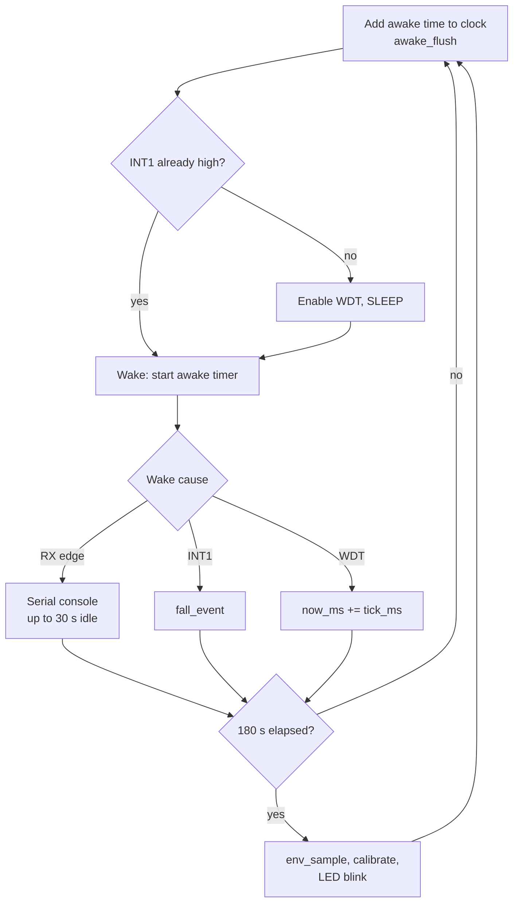
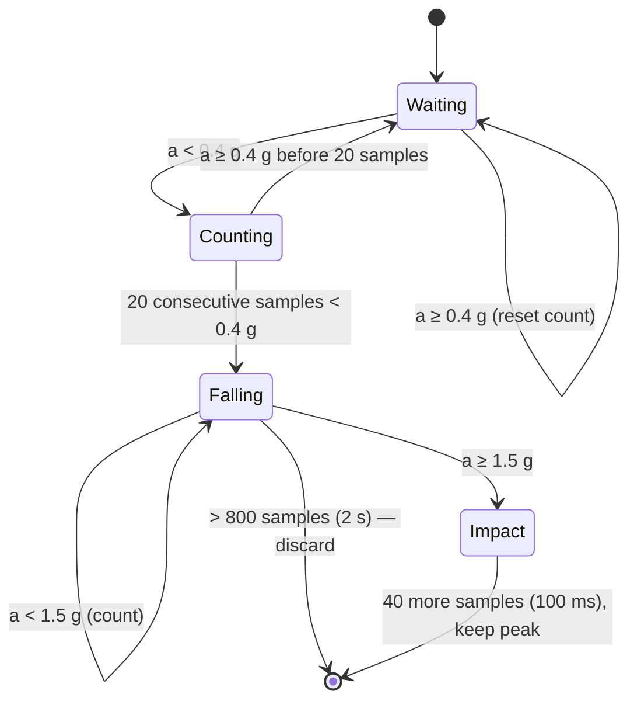

# Firmware architecture

All current firmware is in [`logger/main.c`](../logger/main.c), plus the font
table in [`logger/font5x7.h`](../logger/font5x7.h). It is bare-metal C for XC8:
direct register access, no RTOS, no interrupt service routine, and no vendor
libraries.

Resource use (XC8 v3.00, `-O2`): **7,569 of 8,192 words of program memory
(92.4 %)** and **275 of 512 bytes of RAM (53.7 %)**.

## Modules

The source file is divided into sections, in this order:

| Section | Main functions | Responsibility |
|---|---|---|
| Settings | `#define`s | Sample interval, thresholds, record size, display mode |
| LED / errors | `led_flash`, `fail` | Blink codes at boot. A fault while running triggers `RESET()` so logging continues |
| I²C (MSSP) | `i2c_start/stop/write/read/probe`, `reg_read/write` | 100 kHz master. `i2c_wait` times out and checks for bus collisions |
| ADXL345 | `adxl_init`, `adxl_mag2`, `fall_measure` | 400 Hz, ±16 g full resolution, FIFO stream mode, free-fall interrupt; fall timing |
| AHT20 | `aht20_init`, `aht20_read` | Starts a measurement, waits for busy to clear, converts to °C×10 and %RH×10 |
| 24AA1025 | `ee_read`, `ee_write`, `ee_wait_ready` | Selects the 64 KB block; ACK polling after each write |
| Log | `log_init`, `log_commit` | 16-byte records; binary search for the end of the log after reset |
| SSD1306 | `oled_init`, `oled_line`, `oled_power` | Text without a frame buffer; turns display and charge pump on and off |
| Formatting | `cat_fixed`, `cat_hex` | Integer-to-text with fixed decimals (no `printf`, to save memory) |
| Timekeeping | `calibrate`, `awake_restart`, `awake_flush` | WDT tick calibration and awake-time counting |
| Screens | `show_status`, `show_fall`, `show_fail`, `show_uptime` | OLED layouts |
| Tasks | `env_sample`, `fall_event` | One measurement plus one log record each |
| UART console | `console`, `cmd_status`, `cmd_dump`, `cmd_erase` | 115200 baud command interface, CSV export |
| `main` | — | Boot checks, then the sleep/wake loop |

## Boot sequence

1. Start the 16 MHz internal oscillator. Configure the watchdog for a period of
   32,768 LFINTOSC cycles (about 1 s), but leave it off.
2. Flash the LED three times to show the chip has started.
3. Check that SCL and SDA read high before the MSSP is enabled. If not: error
   code 1 or 2.
4. Probe the OLED (optional), AHT20, ADXL345 (required, error 5) and EEPROM
   (required, error 6). On error 5 or 6, the OLED shows an I²C bus scan and the
   ADXL345 `DEVID` register.
5. Calibrate LFINTOSC. Find the end of the log. Write a **boot record** with the
   measured LFINTOSC frequency and the `PCON` reset-cause flags.
6. Take the first temperature/humidity reading and show the status screen.
7. Enable wake-up on INT (RA2, rising edge) and on a falling edge of the UART RX
   pin. Then enter the main loop.

## Main loop

The PIC wakes from sleep with global interrupts disabled (`GIE = 0`), so no
interrupt service routine is needed. It simply continues after the `SLEEP`
instruction and reads the flags (`IOCBF5`, `INTF`) to find out what woke it.
The watchdog is only enabled around `SLEEP`, so long tasks while awake, such as
a 30 s console session or a log dump, cannot trigger a watchdog reset.

## Timekeeping

The PIC16LF1559 has no Timer1 crystal oscillator, so the watchdog is the only
timer that runs during sleep. Its LFINTOSC clock is not accurate: this unit
measured **29,275 Hz** against 31 kHz nominal.

1. **Calibration** (`calibrate`, at boot and every 180 s): Timer1 counts
   LFINTOSC for 200 ms, timed with `__delay_ms` on the 16 MHz HFINTOSC (factory
   calibrated, about ±2 %).
   `lf_hz = count × 5`, `tick_ms = 32768 × 1000 / lf_hz` (1119 ms on this unit).
2. **Sleep time:** every watchdog wake-up adds `tick_ms`. A wake-up from INT or
   the RX pin happens partway through a period, so it adds `tick_ms / 2`.
3. **Awake time:** Timer1 counts LFINTOSC/8 while the CPU is awake, and
   `awake_flush` adds `count × 8000 / lf_hz` ms. Timer1 overflows after about
   18 s, so long operations call `keep_time()` along the way.

Result (stopwatch, 3 min, display updating every second): **under 1 s error**.
Before step 3 was added, the error was about 3 s per 3 min.

## Fall measurement

The ADXL345 does the low-power detection in hardware. The PIC does the timing.

| ADXL345 register | Value | Meaning |
|---|---|---|
| `BW_RATE` 0x2C | 0x0C | 400 Hz output rate |
| `DATA_FORMAT` 0x31 | 0x0B | Full resolution (3.9 mg/LSB), ±16 g |
| `THRESH_FF` 0x28 | 0x07 | Free fall below 7 × 62.5 mg = 0.44 g |
| `TIME_FF` 0x29 | 0x0A | ...for at least 10 × 5 ms = 50 ms |
| `FIFO_CTL` 0x38 | 0x80 | Stream mode: always holds the latest 32 samples (80 ms) |
| `INT_ENABLE` 0x2E | 0x04 | Free-fall interrupt on INT1 |

When the interrupt arrives, the fall has already lasted at least 50 ms. Those
samples are still in the FIFO. `fall_measure` reads the FIFO history and then
the new samples as they arrive, and runs a small state machine on
|a|² = x² + y² + z², in raw counts at 256 LSB/g:

- The fall time is `t = n × 2.5 ms`, where n counts every sample from the start
  of free fall to the first sample above 1.5 g.
- The height is `h = ½·g·t²`, calculated in integers:
  `h_mm = n² × 981 / 32000`.
- Inside a fall, samples between 0.4 and 1.5 g still count as falling, so a
  rotating body that doesn't read exactly 0 g doesn't end the fall early.
- The impact peak is `√max(|a|²)`, converted to g × 100.

Height resolution comes from the 2.5 ms sample period (Δh/h ≈ 2·Δt/t):

| Height | Fall time | Height resolution at 400 Hz |
|---|---|---|
| 0.2 m | 0.20 s | ±2.5 % |
| 1 m | 0.45 s | ±1.1 % |
| 3 m | 0.78 s | ±0.6 % |

These are quantization limits only. Release dynamics, rotation and threshold
choice add error, and haven't been characterized yet.

Reading one sample takes about 1–1.5 ms on the 100 kHz bus. That's less than
the 2.5 ms sample period, so the loop catches up with the 32-sample backlog
while the fall continues.

## Log format

Records of 16 bytes, starting at EEPROM address 0, up to 8192 records. Each
128-byte EEPROM page holds exactly 8 records, so no write crosses a page
boundary.

| Byte | Boot (0x01) | Environment (0x02) | Fall (0x03) |
|---|---|---|---|
| 0 | type | type | type |
| 1–3 | time since boot, s (LE) | ← | ← |
| 4–5 | LFINTOSC Hz | temperature × 10 (int16) | free-fall samples n |
| 6–7 | `PCON` flags (byte 6); 0xEE = log erased | RH × 10 (uint16) | height, mm |
| 8–9 | — | — | impact peak, g × 100 |
| 15 | checksum: sum of bytes 0–14 | ← | ← |

A temperature of `0x7FFF` means the AHT20 didn't answer.

- **Finding the end of the log:** records are written in order and unused
  EEPROM reads 0xFF, so the first empty record is found by binary search, about
  13 reads.
- **Capacity:** 8192 records at one per 180 s is about **17 days**. Requirement
  5 asks for 2 days.
- **Clean-up:** the earlier EEPROM self-test in `oled/` wrote test data into
  records 4095 and 8191. `log_init` blanks those records if they don't hold a
  valid record type.

## Serial console

- **Wake-up:** a falling edge on RB5/RX sets `IOCBF5`, which wakes the PIC. The
  first character is dropped, so pressing Enter just wakes it.
- **Commands:** single keys: `s`, `d`, `E` (confirm with `y`), `q`. The console
  closes after 30 s without input.
- **Fall detection stays on:** while the console is open, the RA2 pin is polled
  so falls are still measured.
- **CSV columns:**
  `index,time_s,type,temp_C,rh_pct,fall_time_s,fall_height_m,impact_peak_g,samples,note`
- **Baud rate:** `SPBRG = 34` with BRG16/BRGH gives 114,286 baud, −0.8 % from
  115,200.

*The console is implemented and compiles, but hasn't been tested on hardware yet.*

## Earlier firmware

| Folder | Purpose |
|---|---|
| `blink/` | First flash test: toggles RC0 every 500 ms |
| `oled/` | Bring-up of the I²C bus: OLED text, AHT20, ADXL345 X/Y/Z, EEPROM write/read self-test on both 64 KB blocks, LED error codes |

These folders are kept as a record of how the hardware was brought up step by
step.
